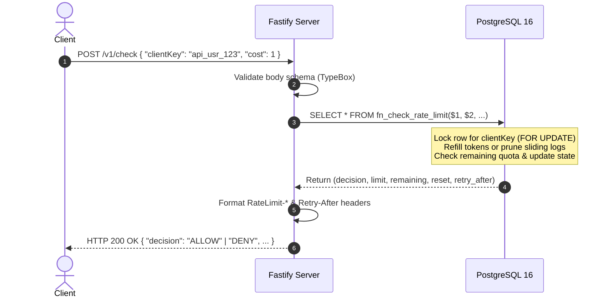

# System Architecture

## 1. Architectural Topology

TBRLS is structured as a decoupled, stateless HTTP rate limiter service that delegates concurrency and state durability to an ACID-compliant PostgreSQL database cluster.

```
                          +-------------------------+
                          |   HTTP Clients / Gateways|
                          +------------+------------+
                                       |
                                       | HTTP JSON (POST /v1/check)
                                       v
                     +-----------------------------------+
                     |      Fastify Application Server   |
                     |  - Input Validation (TypeBox)     |
                     |  - Redaction & Masking Logger     |
                     |  - Admin Auth Hook (X-Admin-Key)  |
                     +-----------------+-----------------+
                                       |
                                       | Parameterized SQL / Function Calls
                                       v
                     +-----------------------------------+
                     |       PostgreSQL 16 Database      |
                     |  - client_policies (config)       |
                     |  - token_bucket_states (buckets)  |
                     |  - sliding_window_requests (logs) |
                     |  - fn_check_rate_limit (atomic)   |
                     +-----------------------------------+
```

---

## 2. Key Component Responsibilities

### 2.1 Fastify HTTP Layer (`src/app.ts` & `src/server.ts`)
- **JSON Serialization & Parsing**: Fastify uses optimized JSON serialization based on pre-compiled TypeBox schemas.
- **Header Enrichment**: Automatically sets standard RFC rate limit headers (`RateLimit-Limit`, `RateLimit-Remaining`, `RateLimit-Reset`, `Retry-After`) on all check responses.
- **Graceful Lifecycle Management**: Handles `SIGTERM` and `SIGINT` signals, closing the HTTP listener and draining the PostgreSQL connection pool without terminating in-flight requests.

### 2.2 Security & Authentication (`src/plugins/auth.ts` & `src/plugins/logger.ts`)
- **Admin Auth Hook**: Compares `x-admin-key` or `Authorization: Bearer <key>` using timing-safe buffer comparisons against `process.env.ADMIN_API_KEY`.
- **Zero-Secret Logging**: Fastify/Pino serializes HTTP logs with automatic key redaction. Client keys are never output in raw form; only truncated masked keys (`clie****`) and cryptographic SHA-256 hashes are logged.
- **Route Template Logging & URL Sanitization**: Inbound request URLs log Fastify's parameterized route template (e.g. `/v1/admin/policies/:clientKey`) instead of raw paths. Unmatched paths log a generic safe placeholder (`<unmatched>`), preventing raw path segments from leaking tokens or client identifiers. Query string parameters are filtered against a strict allowlist (`page`, `limit`); all credentials and arbitrary query parameters (`x-admin-key`, `access_token`, `password`, `clientKey`, etc.) and their values are omitted from logged URLs.

### 2.3 Storage Layer (`src/db/`)
- **Connection Pool**: Bounded `pg.Pool` with connection timeouts and health probes.
- **Automated Migration Runner**: Executes transactional migrations sequentially on application startup, creating tables, indexes, and stored functions.

### 2.4 Rate Limiting Logic (`src/limiter/`)
- Supports dual algorithms:
  1. **Token Bucket**: Dynamically calculates refilled tokens as a function of elapsed time since last check.
  2. **Exact Sliding Window Log**: Maintains rolling timestamps, prunes expired entries, and counts current requests within the window.

---

## 3. Request Lifecycle for `/v1/check`



---

## 4. Concurrency Isolation Model

- Contention is partitioned strictly per `clientKey`.
- When 1,000 requests arrive simultaneously across 100 distinct client keys, the database locks 100 independent rows. Requests for different clients execute in parallel across database connections.
- Concurrent requests for the *same* client key serialize at the database row lock, completely eliminating race conditions and quota double-spending.

---

## 5. Multi-Instance Deployment & Distributed State Sharing

```
                        +----------------------------+
                        |   L4/L7 Load Balancer      |
                        +--------------+-------------+
                                       |
                   +-------------------+-------------------+
                   |                                       |
                   v                                       v
    +------------------------------+       +------------------------------+
    |   TBRLS Instance A           |       |   TBRLS Instance B           |
    |   (Fastify Node.js Process)  |       |   (Fastify Node.js Process)  |
    +--------------+---------------+       +---------------+--------------+
                   |                                       |
                   +-------------------+-------------------+
                                       |
                                       v
                    +------------------------------------+
                    |       PostgreSQL 16 Cluster        |
                    |  (Shared State, Locks, Telemetry)  |
                    +------------------------------------+
```

### Shared Database State Model
TBRLS application instances are **completely stateless**. No limiter tokens, request counts, or client policies are cached in process memory.
- When multiple TBRLS service instances run concurrently behind a load balancer, any request for client `X` can land on any instance.
- Quota synchronization is achieved through PostgreSQL ACID row-level locking (`SELECT ... FOR UPDATE` and atomic PL/pgSQL function `fn_check_rate_limit`).
- **Verified Single-Process Dual-Instance Concurrency**: Integration tests (`tests/integration/multi-instance.test.ts`) verify that two distinct Fastify application instances and two separate database connection pools within a single Node.js process sharing the same PostgreSQL database maintain exact quota enforcement under high concurrency without double-spending. True multi-process deployments (such as multiple container replicas behind an ingress load balancer) use the identical PostgreSQL locking primitives.

---

## 6. Atomic Telemetry Metrics & Live Dashboard

- **Atomic Accounting**: Rate check decisions (`ALLOW` and `DENY`) increment per-client, per-minute buckets in `rate_limit_metrics` directly inside `fn_check_rate_limit` within the same transaction. This eliminates additional roundtrips and guarantees 100% telemetry consistency under load.
- **In-Memory Security for Dashboard**: The live dashboard (`GET /admin/dashboard`) requires `ADMIN_API_KEY`, but stores it **strictly in volatile JavaScript closure memory**. Credentials are never written to `localStorage`, `sessionStorage`, cookies, or the URL.
- **REST Endpoints**: Paginated metrics (`GET /v1/admin/metrics`) and aggregate telemetry (`GET /v1/admin/metrics/summary`) power both the web dashboard and external monitoring systems.

---

## 7. Storage Maintenance & Pruning Architecture

- **Bounded Batch Processing**: To prevent long-running table locks and memory spikes, background maintenance scripts (`src/scripts/cleanup.ts`) execute chunked deletes (`LIMIT 5000` per batch) for expired `sliding_window_requests`.
- **All-Client Coverage**: Unlike in-flight request pruning (which only prunes when an active client makes a check), background maintenance queries all clients—including inactive clients that have stopped sending traffic—using their configured `window_duration_seconds`.
- **Retention Pruning**: Metric records older than the retention threshold (default 24 hours) are pruned via `limiter.pruneMetrics()`.

